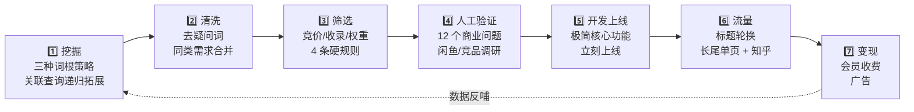

# tool-sidehustle 🛠️

> **程序员副业 SOP：从搜索长尾词挖需求，做一款能赚钱的在线小工具网站**
>
> 把「挖需求 → 筛机会 → 做工具 → 引流量 → 变现」这条完整的副业路径，做成 AI 可以直接执行的标准作业流程（SOP）。

---

## 一、30 秒看懂：这是什么，怎么用（通俗版）

**一句话**：本 skill 把一套付费实战方法论，变成了**装在你项目里的 AI 军师**。以后你在这个项目里跟 AI 对话，它不是给你讲道理，而是**真的动手帮你把「做一个能赚钱的小工具网站」每一步都干出来**。

打个比方：相当于你雇了一位做过工具站的 SEO 老师傅，把他毕生经验写成操作手册（就是本 skill），然后 AI 照着手册替你干活——挖数据、查竞争、写报告，都是真枪实弹。

### 它会带你走的路（7 步）

```
挖需求 → 清垃圾 → 筛竞争 → 定方向 → 做工具 → 引流量 → 赚钱
```

| 步骤 | 通俗解释 | AI 实际干什么 |
|---|---|---|
| 1️⃣ 挖掘 | 看看大家在百度搜什么麻烦 | 自动爬搜索下拉框，滚雪球挖出几百上千个真实搜索词 |
| 2️⃣ 清洗 | 把废话词扔掉、同类合并 | 「图片压缩软件/工具/助手」合并成一件事，查询量少 90% |
| 3️⃣ 筛选 | 排查哪些词竞争小 | 逐个查百度：有几个广告？竞品是谁？是不是没人做网页版？ |
| 4️⃣ 验证 | 这个方向值不值得做 | 按 12 个商业问题打分，去闲鱼/小程序摸竞品底价 |
| 5️⃣ 开发 | 把工具做出来上线 | 按 6 条军规指导（老域名、极简界面、GitHub 找现成代码） |
| 6️⃣ 引流 | 让百度把用户送上门 | 帮你试标题、建功能页、批量铺知乎文章 |
| 7️⃣ 变现 | 收钱 | 会员/广告怎么摆 |

### 怎么用（就 3 步）

**第 1 步：在这个项目文件夹里打开 AI，直接说话**，比如：

- 「我想找个副业方向，从头走一遍」
- 「帮我挖一批『在线 音频』的长尾词」
- 「这批词帮我清洗和筛竞争」
- 「帮我看看 XX 方向能不能做」

**第 2 步：它缺账号时会开口找你要**（平时不用管）：

| 干什么活 | 需要什么 |
|---|---|
| 挖词、查百度、看竞争 | ❌ 什么都不用 |
| 5118 看需求数据 | 浏览器登录 5118（免费注册即可） |
| 批量跑几十万词、查搜索量 | 5118 API Key（付费，可选） |
| 提交收录、发知乎 | 百度账号 / 知乎小号（到那一步才要） |

**第 3 步：拿结果**。所有产出自动存在项目里的 `sidehustle-work/` 文件夹——词库表格、竞争透视表、选品结论报告，都是现成的 CSV 和文档。

### 真实测试效果（2026-11-24 实跑）

不是吹的，完整跑过一遍「挖掘→清洗→筛选」：挖了 **882 个真实搜索词**，清洗成 **463 个需求类**，筛掉 5 个红海（图片压缩、去水印等，广告≥5 挤不进去），最后找到一个**真机会：「音频在线裁剪」**——176 个长尾词可吃、0 个广告、竞品几乎全是海外网站（国内没做好）。详见下文「七、实测验证记录」。

### 一句话记住用法

> **打开 AI → 说人话提需求 → 它动手、你补账号 → 拿表格和结论**

这是一个 Agent Skill（智能体技能包）。AI 会按照本 skill 里沉淀的实战 SOP（源自付费文章《程序员稳定的副业：如何做个小工具》，经 AI 逐图研读原文档 + 实际联网验证后整理成可执行流程）照章办事。

**适合谁**：会写代码的程序员、想做技术副业但不接单、希望做出「睡后收入」产品的人。

---

## 二、核心思想：为什么是「小工具」？

先想一个场景：一个文案正在电脑前工作，突然想把 Word 内容转成一张图片。她会打开抖音吗？不会。她会打开微信搜一搜吗？也不会——小程序麻烦，还要手机电脑传文件。

她只会：**打开百度，搜「在线 word 转图片」，点开第一个工具，用完走人。**

这就是本 skill 的立足点：

1. **搜索仍然垄断工具类需求。** 找工具、下载文件、查简短答案、找官方信息——这类需求几乎不会被短视频/社交平台分流。
2. **工具需求藏在海量长尾词里。** 「图片压缩工具哪个好」「pdf 怎么统计字数」「抖音视频去水印在线」——每个词背后都是真实的人、真实的麻烦。
3. **大部分长尾词竞争极小（流量错位）。** 大厂看不上、小站做不全，仔细挖掘+精确筛选，普通人也能挤进首页。

一句话总结：**别闭门造车想点子，用数据把「用户正在搜索的麻烦」挖出来，挑一个没人做好的，做一个网页小工具去接住它。**

---

## 三、核心工作流：7 个阶段



### 阶段 1️⃣ 挖掘——把用户的话一网打尽

用户搜工具时不会搜「工具」两个字，怎么挖全？三种词根策略：

| 策略 | 逻辑 | 举例 |
|---|---|---|
| **「在线」+ 处理对象** | PC 用户搜网页工具爱加「在线」；但要限定对象（图片/视频/文本/文章…）、平台（抖音/微博/知乎…）、行业（seo/自媒体…）、快速词（批量/一键/极速） | 在线图片压缩、seo在线伪原创 |
| **「器」后缀** | 大量工具叫「XX器」（下载器/转换器/群发器）。单字查不了？借用户习惯加「下载」→ 搜「器 下载」 | 视频下载器、字幕转换器 |
| **计算机操作词** | 工具的一切功能脱离不了操作系统动作：发送/上传/下载/打开/关闭/查询/修改/删除…任意组合 | 一键修改、批量发送、在线查询 |

拿到第一批词后，用**关联查询**滚雪球：把挖到的长尾词分词，提取「陌生词缀」（如从「二手汽车报价」提取「二手」「报价」），再和主词组合成新搜索词入队，循环到挖不出新词缀为止。这一个 BFS 算法已实现为免登录脚本 `scripts/mine_sugrec.py`（基于百度下拉接口，实测可用）。

📌 **产出**：十万级长尾词原始词库（CSV）

### 阶段 2️⃣ 清洗——把垃圾词扔掉

挖得多，噪声也多。两板斧：

- **去疑问词**：包含「哪里/怎么/多少/好不好…」的词直接删——它们只是「图片压缩工具」的延伸问法，真需求词本身一定会被搜到。
- **同类合并**：「图片压缩软件」「图片压缩助手」「在线图片压缩」分词去掉通用词后，核心都是「图片+压缩」→ 归为一类，查询时只挑**最短**的一个当代表。

📌 **产出**：按需求分好类的代表词清单（查询成本大幅下降）

### 阶段 3️⃣ 筛选——4 条硬规则淘汰红海

对每个代表词批量查百度搜索结果，然后：

1. **竞价广告 ≥ 5 条的词，去掉**（有人花钱抢，说明竞争激烈；且要用核心词飘红校准，避免误判）
2. **收录量 ≥ 1000 万的词，去掉**
3. **首页 10 个自然结果里最小网站权重 > 3 的词，去掉**（挤不进首页）
4. **搜索量 top 的词，去掉**（太热的轮不到新站）

再加一个**彩蛋策略**：如果搜索结果全是软件下载站，说明这个需求还没有网页版工具 → 可能是错位机会，标记出来！

📌 **产出**：幸存词清单 + 竞争指标透视表

### 阶段 4️⃣ 人工验证——程序筛数据，人判商业

对幸存方向问 12 个问题（开发成本？反复维护？法律风险？适合收费吗？长尾词丰富吗？功能可延伸吗？…），再去**闲鱼、竞价落地页、小程序**摸竞品的定价和功能，与用户确认后拍板做哪个。

### 阶段 5️⃣ 开发上线——先跑起来再说

6 条军规：老域名、B/S 架构、能用 CMS 就不造轮子、**只做最核心功能立刻上线**、几十块服务器够用、GitHub 先找现成源码。

界面设计只有一个判断标准：**用户会不会为这个功能专门学习你的工具？** 不会 → 极简到一个输入框一个按钮；是专业人群 → 功能丰富反而是友好。

### 阶段 6️⃣ 流量——全靠搜索，不靠转发

- **标题轮换法**：把长尾词按搜索量排序，从上往下逐个拿来当首页标题，收录→查排名→没进首页就换下一个词，直到找到能排首页的词。
- **长尾单页**：一个延伸功能做一个页面，一个页面接住一组长尾词（对标 PDF 站：20+ 功能页 = 20+ 流量入口）。
- **知乎引流**：批量找出「搜索结果里没有知乎链接」的长尾词，一个词写一篇文章（标题完全命中），收录后极易上首页。原文实测：白号发文，日均带 5-10 个下载。

### 阶段 7️⃣ 变现

收费（会员/按次）> 广告，收费后再挂广告。单个需求价值小，融入工具矩阵才有价值。

---

## 四、快速开始

### 安装

把本目录复制到你的 Agent 技能目录（用户级 `~/.agents/skills/` 或项目级 `<项目>/.agents/skills/`）：

```bash
# Windows / macOS / Linux 通用（用户级技能目录）
cp -r tool-sidehustle ~/.agents/skills/
```

### 使用

在你的智能体（支持 Agent Skill 的 AI 编程工具，如 ZCode、Claude Code 等）里直接说：

- 「我想做个小工具副业，帮我从头走一遍选品流程」
- 「帮我挖掘『在线 图片』相关的工具长尾词」
- 「对这批长尾词做清洗和竞争筛选」
- 「帮我的工具站做标题轮换和知乎引流布局」

AI 会按阶段执行，到需要账号的步骤会主动向你要登录/API Key。

---

## 五、自动化能力与账号需求

| 能力 | 方式 | 需要登录/账号？ |
|---|---|---|
| 百度下拉词挖掘（BFS 滚雪球） | `scripts/mine_sugrec.py` | ❌ 免登录 |
| 百度 SERP 抓取（相关搜索/广告识别） | 浏览器自动化（bsk）或低频脚本 | ❌ 免登录 |
| 5118 网页版长尾词查询 | 浏览器自动化 | ❌ 免登录可查（导出需付费会员） |
| 爱站权重查询 | 浏览器自动化 | ❌ 免登录（深度数据需登录） |
| 5118 API 批量挖词/权重/搜索量 | HTTP API（按次付费） | ✅ 需要 5118 API Key |
| 搜索量批量查询（免费替代） | 百度关键词规划师 | ✅ 需要百度竞价账户 |
| 收录提交 / 百度统计 | 浏览器操作 | ✅ 需要百度账号 |
| 知乎引流发文 | 浏览器自动化 | ✅ 需要知乎账号（建议小号） |

> 设计原则：**能免登录的绝不麻烦用户；需要账号的，执行到那一步才向用户索要，并明确说明用途。**

---

## 六、目录结构

```
tool-sidehustle/
├── SKILL.md                  # 技能入口：工作流总览 + 账号清单 + 时代修正
├── README.md                 # 本文件
├── references/               # 各阶段详细手册（执行到哪读到哪）
│   ├── 01-mining.md          #   三种词根策略 + 关联查询算法 + 数据源
│   ├── 02-cleaning.md        #   疑问词表 + 核心词提取
│   ├── 03-filtering.md       #   SERP 数据格式 + 4 条筛选规则 + 错位策略
│   ├── 04-validation.md      #   12 维度评估 + 竞品调研
│   ├── 05-build.md           #   产品建议 + 设计决策
│   ├── 06-traffic.md         #   标题轮换 + 长尾单页 + 知乎引流
│   ├── 07-automation.md      #   已实测的自动化操作手册
│   └── cases.md              #   3 个对标案例拆解
└── scripts/
    └── mine_sugrec.py        # 免登录挖词脚本（已冒烟验证）
```

---

## 七、实测验证记录（2026-11）

| 验证项 | 结果 |
|---|---|
| 百度 sugrec 下拉接口 | ✅ 免登录可用 |
| 百度 SERP 相关搜索 / 广告标识识别 | ✅ 可抓取；「在线图片压缩」实测 5 条广告 |
| 5118 网页版挖词 | ✅ 未登录实测「在线 工具」→ 94,905 条 |
| 爱站综合查询 | ✅ 免登录可见百度/移动/360/必应权重 |
| mine_sugrec.py | ✅ 种子「在线 图片」产出 10 词 + 词频表 |
| ⚠️ 百度快照 | **已下线**——原文「投诉快照更新标题」流程作废，已改为资源平台提交收录方案 |

---

## 八、案例对标（详见 references/cases.md）

1. **PDF 在线转换站**（标杆）：11 年老域名，权重 4，日 IP 约 1.2 万。SEO 很粗糙，赢在 20+ 功能页矩阵——一个功能一个页面，一个页面一组长尾词。
2. **「读出来」语音朗读站**：产品粗糙、无备案、权重仅 PC1/移动3，却仍抢到「语音朗读」（月搜 3713、竞争低）首页末位 + 四五个广告位。证明：挖掘足够仔细，大厂林立的领域也有错位机会。
3. **字体识别站**：首页极简到一个上传按钮，围绕「字体识别」延伸出下载/搜索/社区。

---

## 九、贯穿全程的心法

> - **轻视技术、重视用户**——你以为用户需要一段算法，其实他只需要一段 for 循环。
> - **磨刀不误砍柴工**——挖掘、清洗、筛选做细了，流量是水到渠成的事。
> - **做有积累的事**——打造产品，而不是接单卖时间。
> - **引流只做可积累的**——发论坛可反复曝光，发群是一次性曝光。

---

## 十、版权与免责声明

- 本 skill 的方法论整理自付费文章《程序员稳定的副业：如何做个小工具》（公众号「君言戏语」），仅供购买者本人学习使用，请勿用于商业分发，尊重原作者权益。
- 搜索引擎规则、第三方平台（百度/5118/爱站/知乎）的界面与接口会持续变化，使用时以实际页面为准；数据抓取请遵守各平台服务条款与法律法规，控制频率。
- 本 skill 仅提供方法论与自动化辅助，不构成投资/收益承诺。
